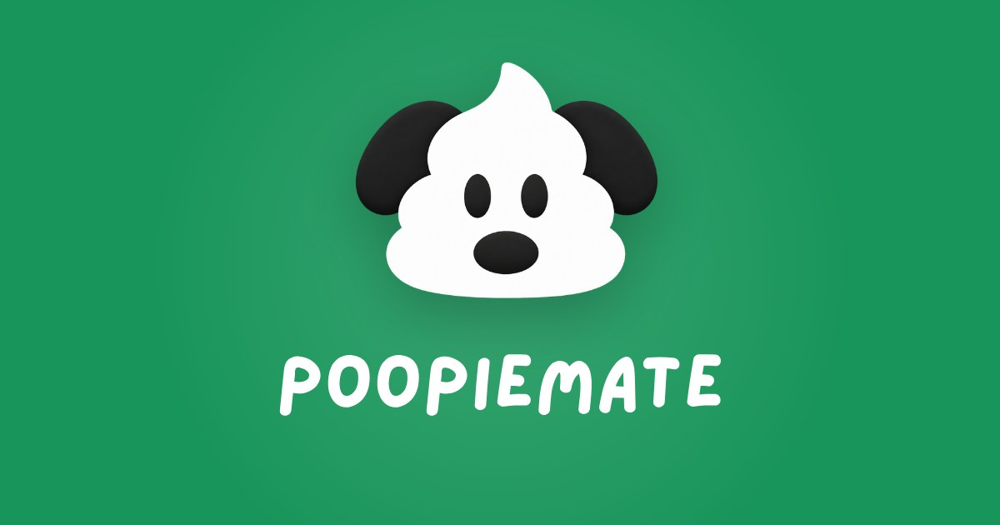
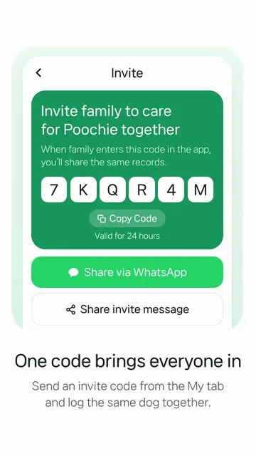
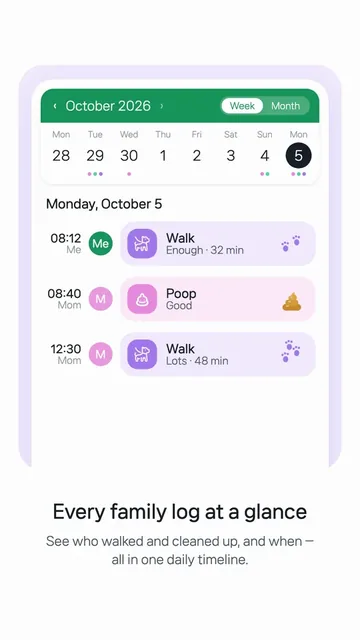
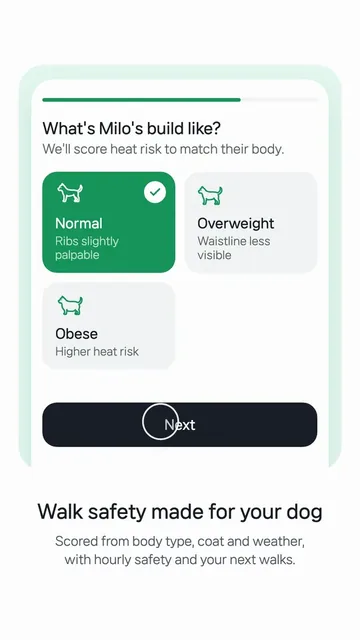

# PoopieMate · 응가메이트

**Your dog’s potty log, shared with the whole family.** 
가족이 함께 보는 우리 강아지 응가 기록.

“Did Poochie poop?” — no need to ask anymore. 
When one person logs a poop, pee or walk, everyone in the family gets an alert right away.

  
  
  

  
  
  
  

## What’s here

| Repository | What it is |
|---|---|
| [`poopiemate`](https://github.com/poopiemate/poopiemate) | The iOS and Android app — Expo, React Native, TypeScript, Supabase *(private)* |
| [`poopiemate-website`](https://github.com/poopiemate/poopiemate-website) | [poopiemate.com](https://poopiemate.com) — Korean and English site, policies and support |

## Find us

  
  
  
  
  
  

Made by [Jin Yi](https://github.com/viva-jinyi) at Pixelberry · [Privacy](https://poopiemate.com/en/privacy/) · [Terms](https://poopiemate.com/en/terms/) · [Support](https://poopiemate.com/en/support/)
